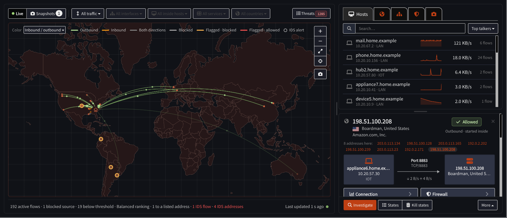

# OPNsense-Firewall-Map

OPNsense 防火墙地图插件：在完整地图和仪表盘地图部件中显示 PF 与 Mihomo 连接，区分正在传输、空闲和等待采样，并提供简体中文界面。

本项目只维护、测试和编译 **os-firewall-map**。适用 OPNsense 26.7 / FreeBSD 15 / amd64。

## 安装与升级

- [最新版安装包与校验文件](https://github.com/Opnwall/OPNsense-Firewall-Map/releases/latest)
- [签名软件源配置](docs/signed-repository.md)
- [GitHub Actions 自动发布说明](docs/github-actions-release.md)
- [Mihomo 数据源说明](docs/mihomo.md)

已配置签名源的设备通过固件更新升级，或执行：

```sh
pkg update -r OpnwallDashboardPlus
pkg upgrade -y -r OpnwallDashboardPlus os-firewall-map
```

兼容说明：仓库已从 `opnsense-dashboard-plus` 更名；软件源 ID `OpnwallDashboardPlus`、现有公钥和设备配置文件名保持兼容。此 ID 不表示本项目仍编译其他插件。旧 GitHub 地址自动重定向到新仓库。

## 构建与发布

```sh
git clone https://github.com/Opnwall/OPNsense-Firewall-Map.git
cd OPNsense-Firewall-Map
sh tools/build-renderer.sh          # 修改前端时运行
sh tools/build.sh                   # 在目标 OPNsense 上仅编译地图插件
```

Actions 使用 FreeBSD 15.1 虚拟机，构建入口固定为 `security/firewall-map`。发布前更新 Makefile 版本和 `releases/firewall-map-VERSION.md`，推送对应版本标签；Release 与签名源使用相同安装包。

地图原始功能和界面说明保留如下。项目派生自 Claudio Guareschi 的 Dashboard Plus，保留原作者版权与 BSD 2-Clause 许可。

## Firewall Map+

The firewall's live traffic on a world map: a dashboard widget, and a full-size page opened with
the expand link on the widget or from **Reporting ▸ Firewall Map ▸ Map** (`/ui/firewallmap`).

> [!IMPORTANT]
> **Get two free keys for the best results.** Firewall Map+ works without them, but it is far more
> useful with both:
>
> - **MaxMind GeoLite2 license key** (free): accurate city-level locations and network (ASN)
>   names. [Sign up for GeoLite2](https://www.maxmind.com/en/geolite2/signup), then create a key
>   under **Manage license keys** in your MaxMind account. If the
>   firewall already has a MaxMind GeoIP alias (**Firewall ▸ Aliases ▸ GeoIP settings**), Firewall
>   Map+ reads the key from there automatically; otherwise enter it in the plugin settings. Without
>   a key the map falls back to the keyless DB-IP Lite databases, which are less precise.
> - **AbuseIPDB API key** (free): the AbuseIPDB blacklist for flagging known-bad addresses, and
>   reputation scores in *Investigate*. [Create an account](https://www.abuseipdb.com/register),
>   then create a key on the **API** page of your AbuseIPDB account and paste it into the plugin
>   settings.
>
> Keys are entered by an administrator in **Reporting ▸ Firewall Map ▸ Settings**. They are
> write-only: never displayed or logged.



*The full-size map draws an arc from the firewall (the house) to every remote
address it is talking to, colored inbound/outbound: green for outbound connections (started inside), orange for
inbound ones (started outside). Red dots are sources the firewall blocked. Other coloring methods are selectable. 
The filters above the map narrow it by traffic type, service, interface, inside host and country; 
**Threats** opens the review list. On the right, **Top talkers** ranks hosts (or countries and networks) 
with a live sparkline, and the details panel below explains whatever you click: here an arc to
Amazon servers in Boardman, Oregon (eight addresses share it; pick one above the diagram), showing
the inside host that opened the connection, the service (TCP 8883), the remote network, the
firewall's decision and rule, transfer totals and rates, with Investigate, States and Kill states
actions.*


*The dashboard widget: the same live map in compact form, with a one-line summary of active flows
and blocked sources. The link in the corner opens the full-size page; its settings dialog (gear
icon) holds the widget's display options.*

### What you see

- **Live connections**: an arc from the firewall to every remote address, from PF state counters
  sampled every 2 seconds (longer on a busy firewall: the collector asks for it, and the map
  follows). The map shows the flows the active [ranking profile](#how-flows-are-ranked) ranks
  highest, up to *Maximum flows on the map* (150 by default). **Green** arcs were opened from inside your network, **orange** from
  outside (port forwards, services on the firewall), gray from both. Pulses travel in the
  direction the data flows. Arcs fade in and out and keep their curve while they live.
- **Blocked attempts**: connection attempts the firewall dropped (from the filter log) pulse in
  red towards the firewall, above a configurable number of hits.
- **Threats in crimson**: traffic to or from an address in a threat list, the AbuseIPDB blacklist,
  a cached AbuseIPDB verdict of 75% or more, your watchlist, or a Suricata alert of severity 1-2.
- **Suricata alerts**: when the Intrusion Detection service runs, its alerts are read locally and
  shown on the address they concern; addresses that alerted without an open connection get a
  hollow marker.

### Plain-language details

Hover or click an arc or an endpoint. Each card starts with the verdict (*Allowed*, *Allowed:
flagged traffic got through*, or *Blocked*), then one sentence per address, for example:

> *This firewall queried DNS (53/udp) at arin.authdns.ripe.net (RIPE NCC, The Netherlands).*

> *94.154.43.203 (Storm Industries LLC, The Netherlands) reached mail (192.168.1.2) on HTTP (80/tcp) through a port forward.*

> *103.155.198.103 (PT Lintas Jaringan Nusantara, Indonesia) tried SSH (22/tcp) and Telnet (23/tcp) on this firewall: blocked 12× in the last 10 min by "Default deny" on WAN.*

> *⚑ Suricata: ET SCAN Potential SSH Scan (severity 2, Attempted Information Leak), 1× in the last 1 h*

### Full-size page

- **Filters**: traffic (all, allowed, blocked, threats that got through, IDS alerts), service,
  interface, inside host, country and network (click an ASN).
- **Color**: inbound/outbound (default), download/upload, egress interface or service, with a
  legend.
- **Top talkers** by host, country and network with sparklines; click one to filter the map.
- **Resizable panels**: drag the handles between the map and the side panel, and between the top
  talkers and the details (double-click resets).
- **Actions** (administrators): *Investigate* (registry via RDAP, routing via RIPEstat and, with a
  key, AbuseIPDB reputation), Whois, AbuseIPDB page, show or kill the address's states, add it to
  an alias, add its country to a GeoIP alias, and *Mark as threat* (adds it to the
  `FWMAP_Watchlist` host alias).

### Snapshots

A snapshot is a saved map document, not a screenshot. When the collector responds, it captures
up to 5,000 active or fading flows, prioritizing IDS/alerting and threat-listed destinations,
then the strongest traffic. The compact document is limited to 10 MiB; unusually large flow
details can be omitted so smaller entries still fit. Truncation never fails a snapshot: what was
left out is counted, and `capture.required_evidence_complete` says whether every flow with
IDS, alert, blocked-source or threat-list evidence made it in full.

PF detail is collected in a second, on-demand traversal and explicitly associated with each
retained logical flow. The 5,000-state evidence budget is shared by quota: incident flows
(those with IDS, alert, blocked-source or threat-list evidence) are guaranteed 80% of it, each
first getting up to 20 states, and every share a flow cannot use goes back to the others. Within
its quota a flow keeps the states with the most bytes, then the newest. Every flow also records
exact totals over all its matching states (count, bytes and packets in each direction), however
many exemplar rows were kept, together with its quota and the reason for any omission. Quiet PF
flows associated with IDS, alerts, blocked sources or threat intelligence remain eligible
independently of the live top-150 ranking. Raw state rows remain protected by the Show States
privilege.

The detail counts and timestamps describe the second traversal, not an atomic copy of the
first: states may disappear, new matching states may appear, and counters may advance.
Generation, matching/captured/omitted counts, per-flow totals and omission reasons are stored in
`capture.states`. The snapshot list, banner and JSON report captured versus available flows,
geographic omissions and PF-row truncation. **Complete detail** means complete within this
capture scope, not a full PF archive: the existing IDS/log evidence limits still apply. Hosts,
Countries, Networks and Top Talkers describe captured flows, not the entire state table. Older
snapshots remain readable but their completeness is unknown.

1. On the dashboard widget or full-size map, select the camera button. The confirmation toast has
   an **Open in full map** link.
2. On the full-size map, open **Snapshots** to browse saved captures, or use the timeline to move
   between captures from a day. Select one to enter snapshot mode; use **Back to live** to return
   to the current map.
3. In snapshot mode, add or edit a note, download the saved document as JSON, or delete the
   snapshot when it is no longer useful.

Snapshots are retained newest first: up to 50 for 30 days, with a combined 100 MB limit. The
camera is rate-limited to one capture every 10 seconds. If the collector is busy and cannot return
the full capture in time, Firewall Map+ saves the current map summary instead and labels it
**summary only**; that snapshot has no connection-state details.

### Threats

**Threats** on the full-size page lists traffic to or from flagged addresses, sorted into tabs by
what actually happened. **Passed / reached host** (the default) holds what got through: a PF state
shows the firewall allowed it, so this is what to look at. **Blocked by firewall** (from the filter
log) and **Dropped by IPS** (Suricata drops) are kept as evidence without piling up as work.
**All**, **Reviewed** and **Dismissed** complete the set.

Each entry shows every threat list the address is on, who it belongs to and where, what it
reached and from which inside host, services, first and last seen, volume and Suricata
signatures. You can investigate, add a note, mark it reviewed or dismissed, and *Block…* adds the
address (IPv4 or IPv6) to an alias you choose; it blocks only if a firewall rule uses that alias.
When history is full (5,000 entries), blocked and dropped entries are removed before passed ones.
Entries you reviewed, dismissed or annotated are kept apart, up to 1,000. Entries are kept for 90
days, counted from the last sighting (for those, from the last sighting or status change,
whichever is later).

While the widget is on a dashboard, threat history keeps being fed in the background (a light
sample every 20 seconds) even with no map open; switch this off in the Threats footer.

### Threat lists

Threat lists only **mark** traffic; no firewall rule is added or changed unless you use an alias in
a rule yourself. Choose them in **Reporting ▸ Firewall Map ▸ Settings**:

- Curated feeds, downloaded daily by Firewall Map+: Spamhaus DROP, abuse.ch Feodo Tracker,
  Emerging Threats compromised hosts, FireHOL level 1.
- Any URL-table or external alias of your own (e.g. CrowdSec).
- With an AbuseIPDB API key: the AbuseIPDB blacklist (up to 10,000 IPv4 and IPv6 addresses at
  100% confidence, one download a day) and the verdicts of your *Investigate* lookups (flagged at
  75% or more; a separate cache).
- `FWMAP_Watchlist`, filled by *Mark as threat*.

**Maintain blocklist aliases** (in the settings) keeps a `FWMAP_*` alias for each selected curated
feed (a daily URL table) and, with a key, `FWMAP_AbuseIPDB` (filled from the downloaded blacklist,
IPv4 and IPv6, after each download and at boot). Firewall Map+ adds no rules: use the aliases in
your own block rules, on the interfaces you choose. The map itself works from its own daily copy of
each selected feed, so the lists count for flagging with the switch off too. Turning it off, or
deselecting a feed, removes the aliases Firewall Map+ made, but only once no rule uses them; aliases
of your own are never touched. On upgrade the switch starts on where `FWMAP_*` feed aliases
already exist. Uninstalling leaves the aliases in place (rules may still refer to them).

### IPv6

Everything works for IPv4 and IPv6: PF states and the filter log, routed IPv6 prefixes behind the
firewall, threat lists (separate compact IPv4 and IPv6 indexes), AbuseIPDB, GeoIP and ASN lookups,
investigations, the Threats panel and *Block…*. An address with a port reads `[2001:db8::1]:443`.

### Suricata (Intrusion Detection)

No setup is needed in Firewall Map+: alerts from `/var/log/suricata/eve.json` appear as soon as
Suricata raises them. Suricata only matches most rules when one side is in its *Home networks*.
When it monitors the WAN interface it sees addresses before NAT, so add your WAN address(es) to
*Home networks* (Services ▸ Intrusion Detection ▸ Administration), or monitor the LAN interfaces
instead.

### Settings

The plugin settings are in **Reporting ▸ Firewall Map ▸ Settings** (administrators), in four
tabs; press **Apply** after saving. When *Maximum flows on the map* or the active profile changes,
Apply restarts the collector and open maps wait for its first ranked sample.


*The General tab with OPNsense's advanced mode on; the settings marked with a gear are hidden
until it is switched on.*

- **General**
  - *Record in the background* keeps recording threats while no map is open, as long as the
    widget is on a dashboard.
  - *Maximum flows on the map* (Collector, 25 to 1000, default 150): how many flows the collector
    ranks and sends to the map each sample. More flows take more processing time and memory (at
    1000 flows and a 2-second refresh, each open map receives 1 to 2 MB of JSON a refresh); it
    never limits firewall states or connections.
  - *Country blocklists* (OPNsense GeoIP aliases) and *Operational sets* (PF tables with a meaning
    of your own: partners, cloud providers...) name the sets a remote belongs to on the map.
    Selecting one blocks nothing and never marks traffic as a threat.
  - *Log administrator actions* (see Log File below).
  - With **advanced mode** on: *Firewall map location* (where the firewall sits on the map:
    normally its public WAN address, geolocated with the configured database; *Use external
    public IP discovery* for a WAN behind upstream NAT, which finds the public address with
    api.ipify.org and geolocates it the same way (behind upstream NAT the map shows your
    network's traffic, but not the firewall's own connections, such as its DNS lookups or a
    VPN it opens itself); or manual latitude and longitude, which win;
    and *IPv6 location*: IPv6 joins the IPv4 location when any precise IPv6 location of the
    firewall, its inside prefixes first, is within 50 km of it or within the two locations'
    accuracy. A location known only by country never counts, and tunnel and VPN interfaces are
    never used. *Automatic* shows a second house only for IPv6 precisely located elsewhere;
    *Same as IPv4* always shows one. The Status page names the address each house comes from),
    *High availability* (*On a CARP backup*: mirror the master's connections, or show only this
    firewall's traffic) and the collector's tuning: *Shortest* and *Longest refresh interval*
    (2 to 300 seconds; on a busy firewall the collector asks for a longer one, within these
    bounds, and the map follows) and *Memory budget* (empty: 5% of physical memory, at most
    1024 MiB). The memory budget bounds the state collector and sets the largest PF state table
    the map processes; above it the map says the state table is too large instead of slowing the
    firewall.
- **Geolocation**: the geolocation service (automatic, MaxMind GeoLite2, MaxMind GeoIP2 City,
  DB-IP Lite), the MaxMind license key (taken from a MaxMind GeoIP alias when present) and how
  often the database is updated.
- **Security**: threat lists, the AbuseIPDB API key and *Maintain blocklist aliases*.
- **Profiles**: the ranking profiles, below.

Keys are write-only and never displayed or logged: leave a key field empty to keep the stored key,
or tick *Remove the stored key* to delete it.

### How flows are ranked

A busy firewall holds far more connections than a map can show. Each sample, the collector scores
every flow with the active ranking profile and sends the best ones, up to *Maximum flows on the
map*:

1. **Score.** The profile's *ranking priorities* weigh eight properties of a flow, each a
   percentage, together 100:

   | Priority | What it measures |
   |---|---|
   | Data rate | Smoothed bytes per second, both directions |
   | Packet rate | Smoothed packets per second |
   | Connections | Active PF states |
   | Connection rate | New PF states per second |
   | Total data | Bytes moved since the flow's current activity began |
   | Blocked activity | Blocked attempts from the remote in the firewall log (rules with logging) |
   | Threat reputation | The remote is in a selected threat list (such as a curated feed or the AbuseIPDB blacklist) |
   | IDS alerts | Suricata alerts for the remote; high-severity alerts count double |

   *Asset importance* then multiplies the score of flows from chosen local hosts or networks (1
   to 100; a flow takes its local host's longest matching rule). Flows that never moved data are
   left out, handshake-only probes count once they reach 10 attempts, and a flow already on the
   map keeps a slight edge so the map does not flicker.
2. **Security visibility.** A flow with security evidence belongs to one class: **S3**
   high-severity Suricata alerts (severity 1 or 2); **S2** other Suricata alerts, or at least 30
   logged blocked attempts; **S1** any other evidence (a threat list match, an abusive AbuseIPDB
   lookup, fewer blocked attempts). The profile reserves a minimum share of the map's places for
   each class, rounded up (30% of 150 is 45 places). S3's best-scoring flows fill its reserved
   places first, then S2's, then S1's.
3. **Everything else by score.** The remaining places go to the best-scoring flows overall,
   security flows included, so a class can take more than its share. Places a class does not use
   go to general ranking.

The map never shows more than *Maximum flows on the map*, and the browser draws every flow it is
sent.

### Ranking profiles

Exactly one profile is active, chosen in the **Profiles** tab's *Active* column (it takes effect on
**Apply**). Four are built in:

- **Balanced** (the default): traffic, connections and flow volume together, with security
  evidence counted and a few places kept for flows that carry it.
- **Bandwidth**: the flows moving the most data.
- **Connections**: the most PF states and the most new connections, whatever their traffic.
- **Security**: flows with security evidence first, then connection activity.


*Built-in profiles are shown read only (ⓘ) and cloned to make your own; **+** adds a profile
starting from Balanced. Your profiles can be edited, cloned and deleted (except the active one).*


*The profile editor. **Security visibility** splits the map's places: General ranking and the
minimum reserved shares of S1, S2 and S3. **Ranking priorities** shows how much each property
counts. Drag a splitter to move percentage points between its two neighbours only (hovering names
them; the arrow keys move 1 point, Shift 5), so a bar always totals 100, or type exact values:
the editor shows what is left or over and keeps Save disabled until the split is valid. Values
are whole percentages; a 0% property keeps a narrow striped slot. Asset importance takes one rule
per line (`192.168.1.25 10`, `192.168.10.0/24 3`).*

**Reporting ▸ Firewall Map ▸ Status** shows the installed Firewall Map version, whether the collector
is running (with the usual start, stop and restart controls), how fresh the geolocation database, the
threat feeds and the AbuseIPDB blacklist are, and any download errors. Each has an *Update now* button.
Its *State collector* section shows the state collector (`/usr/local/libexec/firewallmap-collector`):
whether it is running, its collector protocol and the expected one (1), its process, restarts and the
PF state ABI it was built for, the state limit its memory budget allows, the cost of the last sample,
the flows on the map (the last sample's ranked flows of the maximum), whether the classification
snapshot is current (a failed refresh keeps the previous PF tables, marked stale, with the reason),
anything left out (unsupported states, candidates or threat remotes over their budgets) and the last
refusal or error. A collector that speaks another protocol means the package's components come from
different versions: the status says *Incompatible* and the fix is to reinstall or upgrade the
Firewall Map package. An administrator can check the collector against the running kernel with
`configctl firewallmap collector selftest`.

**Reporting ▸ Firewall Map ▸ Log File** is the plugin's log (System ▸ Settings ▸ Logging sets how long
it is kept and can forward it). It records what helps diagnose a problem, without one line per
sample: the collector starting and stopping (and why), a map being opened or closed, each download
of the geolocation database, the threat feeds and the AbuseIPDB blacklist with its result, settings
being applied (with the blocklist aliases created or removed), and errors, each logged once with
its recovery. Keys are never logged. Please include this log when asking for help. With *Log
administrator actions* on (off by default), it also records who investigated an address, changed
or deleted threat entries, and saved, annotated or deleted snapshots.

Each widget's display options are in its own settings dialog (gear icon on the widget): busiest-arc
highlighting, city labels, blocked traffic and its minimum hits, hostname lookups and network (ASN)
names. The map draws every flow the collector sends (see *Maximum flows on the map*).

### What leaves the firewall

| When | Where | What is sent |
|---|---|---|
| Geolocation database update (every few days) | MaxMind or DB-IP | Your MaxMind key (MaxMind only). Lookups themselves are local. |
| Daily, with an AbuseIPDB key | AbuseIPDB | Your key, to download the blacklist. |
| Threat-list aliases (daily, OPNsense's alias updater) | The list provider | The download request only. |
| *Investigate* clicked | rdap.org, stat.ripe.net, AbuseIPDB | The one address being investigated. |
| *Look up hostnames* enabled | Your DNS resolver | Reverse lookups of remote and unnamed inside addresses. |
| *Use external public IP discovery* on, and the WAN has only a private address (at most every 15 minutes until it answers, then once a day) | api.ipify.org | A plain HTTPS request; the reply is the firewall's public IPv4 address, geolocated locally. |

The collector runs while a map is open, or in the background while the widget is on a dashboard
and background recording is on. It uses a few percent of one CPU core while a map is open.


## License

BSD 2-Clause, see [LICENSE](LICENSE). Firewall Map+ bundles deck.gl and luma.gl (MIT) and Natural
Earth data (public domain); DB-IP Lite data is CC BY 4.0; MaxMind GeoLite2 is subject to MaxMind's
EULA. See [THIRD_PARTY_NOTICES](security/firewall-map/THIRD_PARTY_NOTICES).
